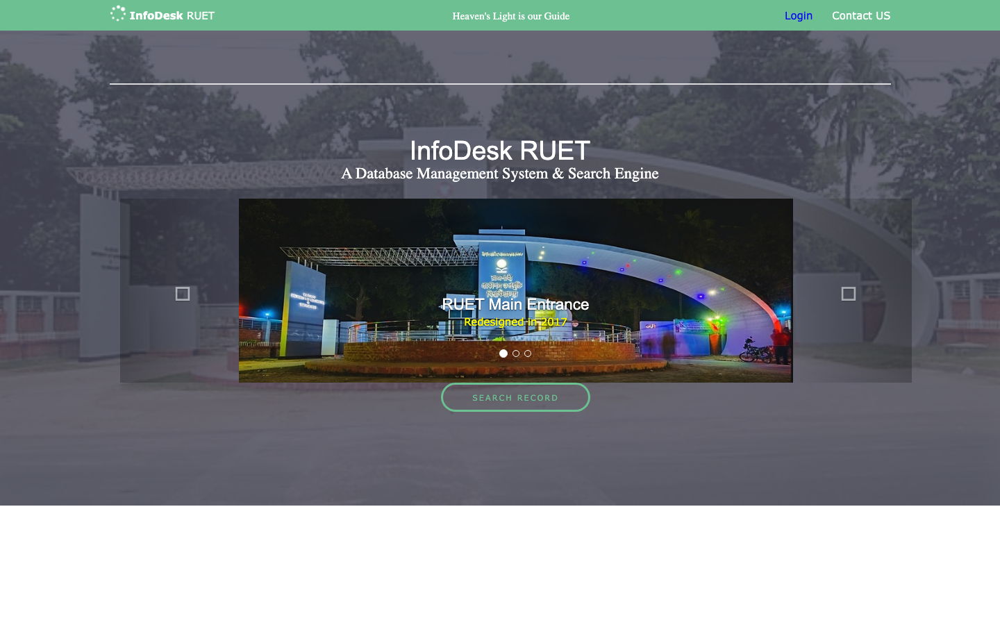
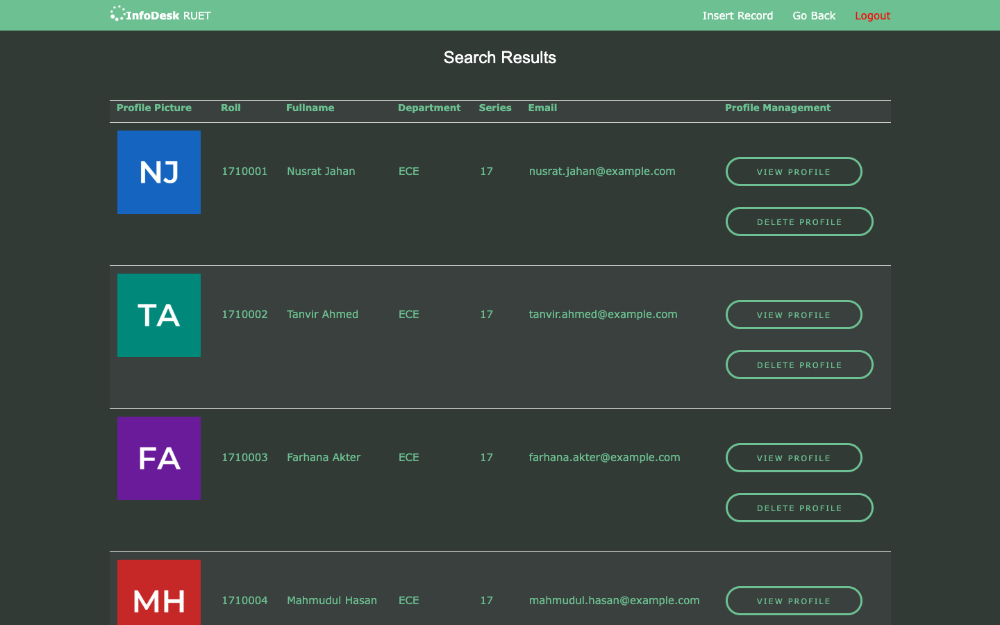
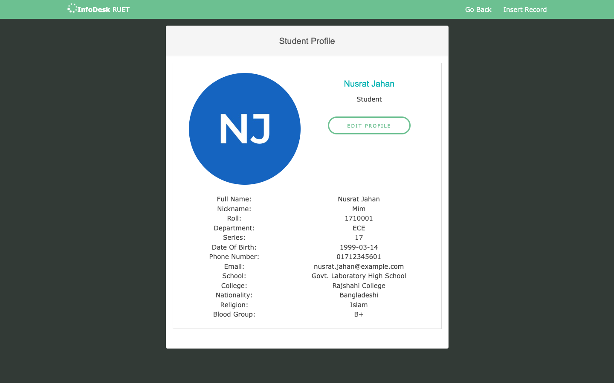
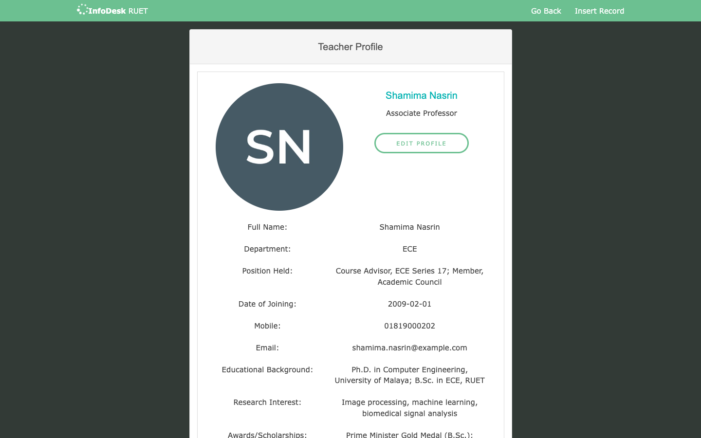
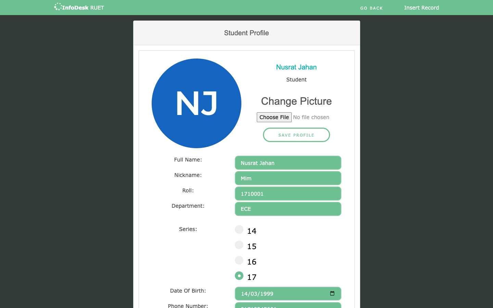
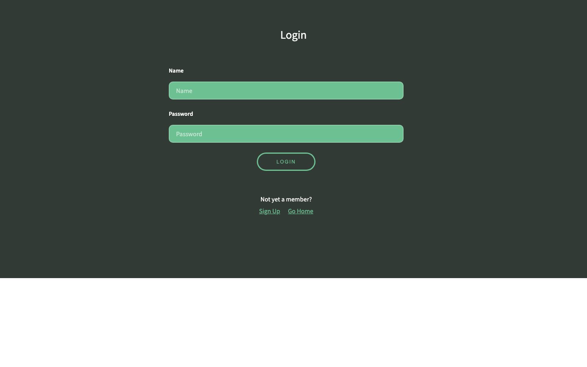

# ROPMS: InfoDesk RUET

**InfoDesk RUET** is a PHP and MySQL information desk and search engine for students and teachers of Rajshahi University of Engineering & Technology (RUET). Visitors search student and teacher records; registered users can add records, and people can keep their own profile up to date.

## Screenshots

Screens from a local run with sample data (1440 × 900).

<table>
  <tr>
    <td align="center" valign="top">
       
      <b>Landing page</b> Campus carousel and Search Record
    </td>
    <td align="center" valign="top">
       
      <b>Search results</b> Students of ECE series 17, as admin
    </td>
  </tr>
  <tr>
    <td align="center" valign="top">
       
      <b>Student profile</b> Seen by its owner, with Edit Profile
    </td>
    <td align="center" valign="top">
       
      <b>Teacher profile</b> Designation, positions, education, research
    </td>
  </tr>
  <tr>
    <td align="center" valign="top">
       
      <b>Edit profile</b> Update details and change the picture
    </td>
    <td align="center" valign="top">
       
      <b>Login</b> Sign in or sign up
    </td>
  </tr>
</table>

## Features

- **Search** students by name, email or roll, and teachers by name or email, with department and series filters. Searching for `All` (or leaving the box empty) lists every record.
- **Result tables** with profile photos and links to each profile.
- **Profile pages** for students (roll, series, contact, blood group, schools and more) and teachers (designation, positions held, education, research interests, awards, publications and more).
- **Add records** for students and teachers, with a photo upload.
- **Edit your own profile**: when your login email matches a profile's email, you can edit it and change its picture.
- **Admin**: the `admin@localhost` account can delete any profile.
- **Accounts**: sign up, log in and log out.

## User roles

| Role | Can do |
| --- | --- |
| Visitor | Search and view student and teacher profiles |
| Registered user | Everything a visitor can, plus add student and teacher records |
| Profile owner | Edit or delete their own profile |
| Admin (`admin@localhost`) | Delete any profile |

## Tech stack

- PHP with `mysqli` (tested on PHP 7.4 with Apache)
- MySQL / MariaDB (tested on MariaDB 10.6)
- Bootstrap 3, w3.css, Font Awesome and jQuery on the TEMPLATED "Projection" theme

## Database

The app uses a database called `ruet`:

| Table | Holds |
| --- | --- |
| `users` | Login accounts: username, email, password |
| `batch_1410`, `batch_1510`, `batch_1610`, `batch_1710` | Students of ECE series 14 to 17, one table per series (roll is the key) |
| `teachers` | Teacher profiles |

Profile pictures are saved in `images/`, named `<roll>.jpg` for students and `<mobile>.jpg` for teachers.

## Run it locally (XAMPP)

1. Copy the project folder into XAMPP's `htdocs`.
2. Start Apache and MySQL. The app connects to `localhost` as `root` with an empty password (see `connect.php`).
3. Create the `ruet` database with the `latin1` character set (the `teachers` table is too wide for `utf8mb4`) and create the tables listed above.
4. Open <http://localhost/ROPMS/start.php>.

## Notes

This was a 2020 university project and is not meant for production. Queries are built from strings rather than prepared statements, passwords are hashed with MD5, student search covers ECE series 14 to 17 only, and the results page is a placeholder.

## Author

**Md Khalid Syfullah**: [GitHub](https://github.com/Khalid-Syfullah) · [LinkedIn](https://linkedin.com/in/khalid-syfullah)
